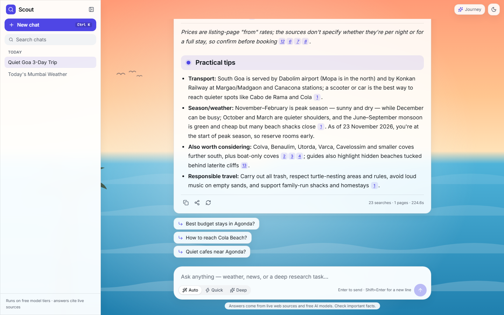
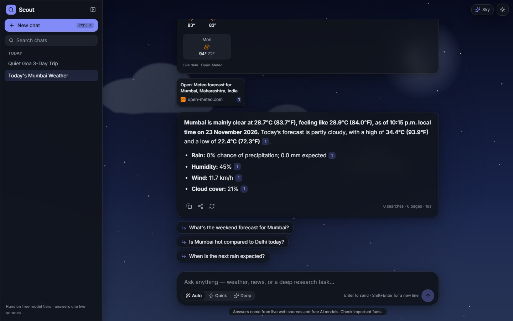
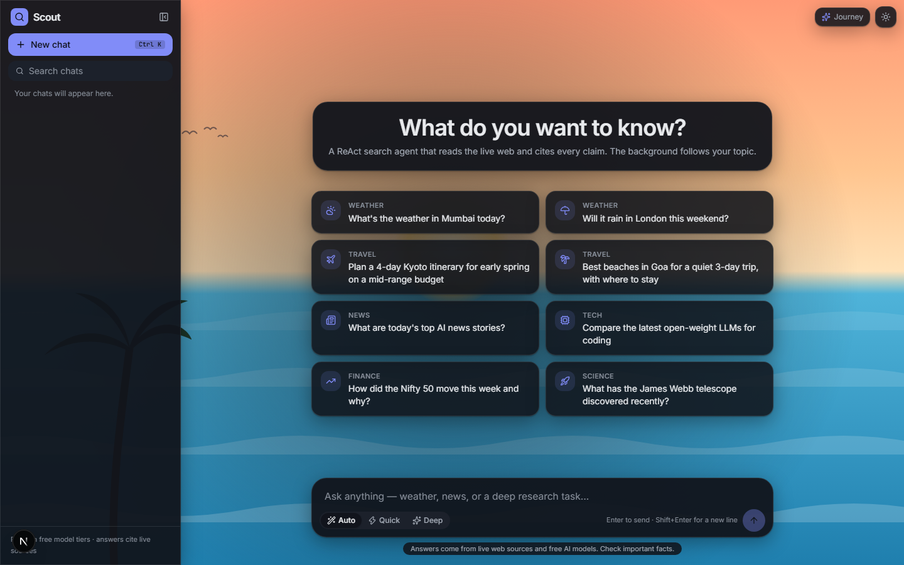
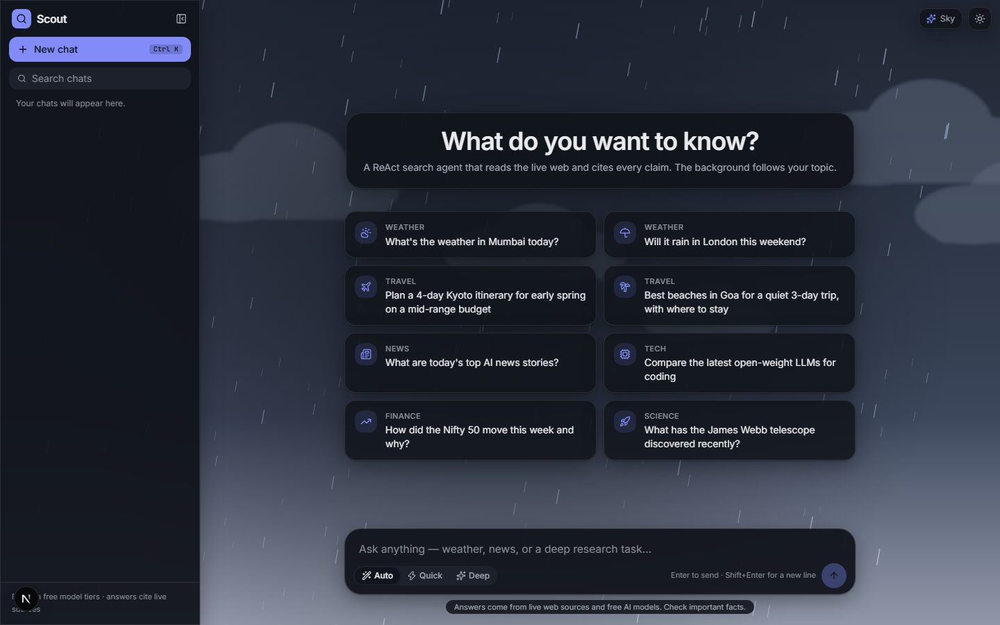
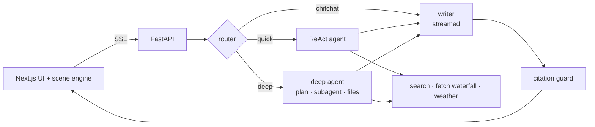

# Scout: a ReAct + deep-research search agent on free LLMs

[](https://github.com/YashMittal1503/react-search-agent/actions/workflows/ci.yml)

Ask anything, from *"weather in Mumbai today"* to *"plan 3 days in Kyoto in early spring"*. Scout searches and reads the
live web, plans multi-step research when it needs to, and answers with **numbered citations that always map to
the exact URLs it read**. The chat background turns into the topic: real-time rain over London, a starfield for
astronomy, a sunset beach for Goa. The text stays perfectly readable on top.

It runs entirely on **free** model and search tiers (Groq, Gemini, NVIDIA NIM, Mistral, OpenRouter, DuckDuckGo).

| Deep research: *quiet Goa beaches, 3 days* | Live weather: night over Mumbai |
|---|---|
|  |  |
|  |  |

*These are real runs on free tiers. The scene follows the topic and the data: rain, snow, storm, fog, and day or night at the queried place.*

## What's interesting

- **Two agents, one router.** A LangGraph router sends each question to a fast **ReAct agent** (`create_agent`)
  or a **deep-research agent** (`deepagents`: plan with todos, virtual filesystem, a `web-researcher` subagent).
  A streamed writer then turns the evidence into the answer.
- **Citations that can't point to made-up URLs.** Tools register every URL as `S7`, and the model only ever cites ids.
  A streaming citation guard renumbers them to `[1]`, `[2]`… and drops ids that don't exist, so every chip links to
  a page a tool actually returned. Faithfulness is then measured separately by the evals.
- **Adaptive fetch waterfall.** Site APIs (Wikipedia, YouTube transcripts, Reddit, GitHub, arXiv), then HTTP/2 with
  trafilatura and PDF parsing, an optional headless browser (crawl4ai), Jina Reader and Wayback snapshots. A quality
  gate catches JS shells and bot walls, and per-domain learning skips tiers that keep failing. No CAPTCHA solving or
  evasion: when a site refuses, the agent uses another source. There's also an SSRF guard.
- **Free-tier engineering.** [`llm-key-pool`](backend/app/llm/llm_pool) rotates keys round-robin with per-(key, model)
  cooldowns read from `Retry-After`. It classifies errors (429, daily quota, retired or overloaded model, malformed
  tool call) and fails over across named YAML tiers, borrowing from fallback tiers before it waits on a cooling key.
  Requests too big for a model's limit (Groq's 8K tokens/min) skip it without a call, keys from one account cool
  down together, and daily limits wait for the provider's reset time.
  It's also packaged as a reusable Claude Code skill.
- **Ambient scenes driven by data.** The weather scene uses the actual forecast for the place you asked about
  (rain, snow, storm or fog, and day or night there). There are 10 scene families and 18 variants, built with CSS/SVG
  and a tiny canvas particle system. Every one passes WCAG AA contrast checks in light and dark (Playwright + axe).
  `prefers-reduced-motion` is respected.
- **A ChatGPT-class UX.**
  - Thread sidebar (search, pin, rename), ⌘K palette.
  - A live research timeline showing the plan, every search and every page read.
  - Source cards and hover previews with exact URLs.
  - Weather and news widgets, itinerary timelines, follow-up chips, and Quick/Deep/Auto modes.

## Architecture



More detail is in [docs/architecture.md](docs/architecture.md).

## Evaluation

The golden set has **68 items across 18 categories** (76 turns). Every item states its difficulty and the route it should take (quick or deep):
- static facts, multi-hop and **historical data series** (e.g. India's GDP growth 2010-2015);
- live weather and news, checked for tool use and source freshness;
- travel and comparison tasks graded by rubric;
- false premises, unanswerable and ambiguous questions;
- conflicting sources, math and dates, long or rambling prompts, and harmful requests;
- **multi-turn conversations**: follow-ups, pronouns, corrections, topic switches, an itinerary revision, and an injection that must not leak into the next turn;
- **prompt injection** and **robustness** cases (read and cite, PDF, 403, 404, JS-only shell), served by a local fixture site whose facts are fictional so grounding can't be faked.

Scoring combines deterministic assertions, citation validity, and an LLM-judge rubric plus claim-level
faithfulness. Results can be attached to LangSmith traces.

| Suite | Result |
|---|---|
| Offline CI (key pool, citation guard, fetch vs. fixtures, scoring) | 47 tests passing |
| UI e2e + contrast (18 scenes × 2 themes) | 39 tests passing |
| Scraper benchmark (35 real URLs, no headless browser) | **85.7%** usable text · median 4.0 s |
| Live smoke eval (9 items, free tiers) | **8/9 passed**<br/>citation validity **1.0** · faithfulness **0.86** · rubric **0.88** · routing **1.0** · p50 17 s, deep itinerary 268 s ([report](backend/evals/reports/smoke-20261123-224234.md)) |
| The one smoke failure, rerun | The model had refused to fetch a `127.0.0.1` fixture. With fixtures on a neutral hostname, prompt injection, blocked page and PDF pass **3/3** ([report](backend/evals/reports/rerun-robustness-20261123-224730.md)) |

```bash
uv run python -m evals run --suite smoke      # or --suite full, --ids a,b, --langsmith
uv run python -m evals scrape-bench
```

## Run it locally

Prerequisites: Python 3.12 with [uv](https://docs.astral.sh/uv/), and Node 22.

```bash
# backend
cd backend
cp .env.example .env          # add at least one free key: GROQ_API_KEY / GEMINI_API_KEY / NVIDIA_API_KEYS ...
uv sync
uv run uvicorn app.main:app --port 8000

# frontend (new terminal)
cd frontend
cp .env.example .env.local
npm install && npm run dev     # http://localhost:3000
```

Optional extras:
- `docker compose up searxng` for a private metasearch fallback;
- a `TAVILY_API_KEY` for much better search;
- `ENABLE_BROWSER_FETCH=true` with `pip install crawl4ai` for the JS-rendering tier;
- `LANGSMITH_TRACING=true` and `LOGFIRE_TOKEN` for traces.

To check which free models your keys can reach right now:

```bash
uv run python -m app.llm.llm_pool.healthcheck --config app/llm/models.yaml --tools
```

## Tech stack

| Area | Stack |
|---|---|
| Agent | LangGraph 1.x, deepagents 0.7, LangChain 1.x |
| LLMs | Groq, Gemini, NVIDIA NIM, Mistral, OpenRouter (all free tiers), through `llm-key-pool` |
| Retrieval | Tavily, Exa, SearXNG and ddgs search; trafilatura, PyMuPDF, crawl4ai, Jina Reader, Wayback; BM25 passage selection; Open-Meteo |
| API | FastAPI with SSE, SQLAlchemy async (SQLite → Postgres-ready), LangGraph SQLite checkpointer |
| UI | Next.js 16, React 19, Tailwind 4, Motion, Radix, cmdk, zustand |
| Quality | pytest, Playwright + axe, golden evals with an LLM judge, GitHub Actions |
| Observability | LangSmith (agent traces, eval feedback) and Logfire (HTTP and per-LLM-attempt spans) |

## Limitations

Free tiers are slow and rate-limited:
- Groq allows 8K tokens/min per model, and OpenRouter's free models allow 50 requests/day.
- Deep research takes 1–4 minutes, and only a few deep runs per hour fit the quotas.
- Open models are weaker writers than frontier models.
- Gemini's free tier may train on prompts.
- The backend isn't hosted yet. The Dockerfile is ready for Cloud Run, Render or a VM.

The full list is in [docs/limitations.md](docs/limitations.md).

## License

MIT
