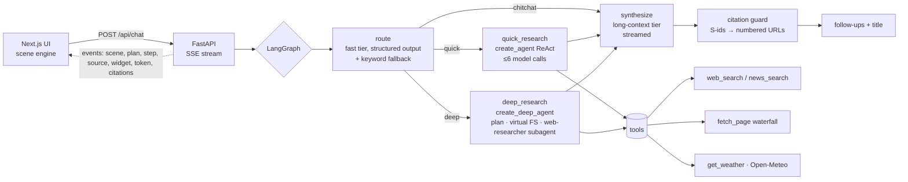

# Architecture

## Request flow



## Key ideas

**1. Citations that can't point to made-up URLs.** Every URL a tool returns is registered in a per-run
`SourceRegistry` and shown to the model as `[S7]`. The model never writes URLs. While the answer streams,
`CitationStreamer` rewrites `[S7]` to reader-facing `[1]`, `[2]`… in order of first use, drops ids that don't
exist and strips raw URLs. So each number in the UI maps to a URL a tool really returned. The evals measure this
(`citation_validity`) and separately judge whether the source supports the claim (`faithfulness`).

**2. Adaptive fetch waterfall** (`app/tools/fetch/waterfall.py`)

```
cache → site API (Wikipedia, Wikivoyage, YouTube transcript, Reddit JSON, GitHub, arXiv)
      → HTTP/2 + trafilatura (HTML, PDF via PyMuPDF)
      → headless browser (crawl4ai, optional)
      → Jina Reader → Wayback Machine snapshot
      → structured failure ("blocked: 403") so the agent picks another source
```

Each result passes a quality check that catches "enable JavaScript" shells, bot walls and empty pages. Per-domain
stats remember which tier worked and skip tiers that keep failing there. A per-domain semaphore keeps it polite.
An SSRF guard refuses localhost and private networks. Only the passages most relevant to the question (BM25) reach
the model.

**3. Free-tier engineering.** The [`llm-key-pool`](../backend/app/llm/llm_pool) package (also a reusable Claude
Code skill) rotates keys per provider and keeps cooldowns per (key, model), using `Retry-After` and
"try again in 7m4s" messages. It classifies errors (rate limit, daily quota, retired model, too large, malformed
tool call, overloaded, auth) and fails over across named tiers:

| Tier | Used for | First choice |
|---|---|---|
| `fast` | routing, follow-ups | Groq qwen3.8-27b |
| `agent` | quick ReAct, research subagent | Groq gpt-oss-120b |
| `deep` | deep orchestrator (big context) | NVIDIA minimax-m3.1-flash |
| `long_context` | final synthesis | Gemini 3.8 Flash (1M ctx) |
| `judge` | eval grading | Gemini 3.5 Flash |

`ContextEditingMiddleware` clears old tool outputs once the agent's context passes a threshold. The excerpts stay
in the registry, so the writer still sees them.

**4. Ambient scenes.** The client guesses a scene from keywords the moment you press send. The router then
confirms it, and the weather tool refines it with **real data** (rain, snow, storm or fog, and day or night *at the
queried place*). Scenes are CSS/SVG plus a tiny canvas particle system, with no WebGL. Readability is a design
constraint, not luck:
- text only ever sits on ≥86%-opaque blurred surfaces;
- a vignette dims the centre;
- Playwright + axe check WCAG AA contrast for 18 scenes × 2 themes;
- `prefers-reduced-motion` freezes animation, and scenes can be switched off.

**5. Memory and storage.** A LangGraph `AsyncSqliteSaver` checkpointer keeps conversation state per thread. Thread
and message metadata for the UI live in SQLAlchemy (SQLite, or any async URL such as Postgres/Neon). Users are
anonymous: a random id in localStorage, plus per-IP daily limits.

**6. Observability.** LangSmith gets the full agent trace when `LANGSMITH_TRACING=true`. Logfire records
FastAPI, httpx and a span per LLM attempt (provider, model, masked key). Both share the `run_id`. With
`--langsmith`, the eval runner attaches scores as LangSmith feedback on each run's trace.
